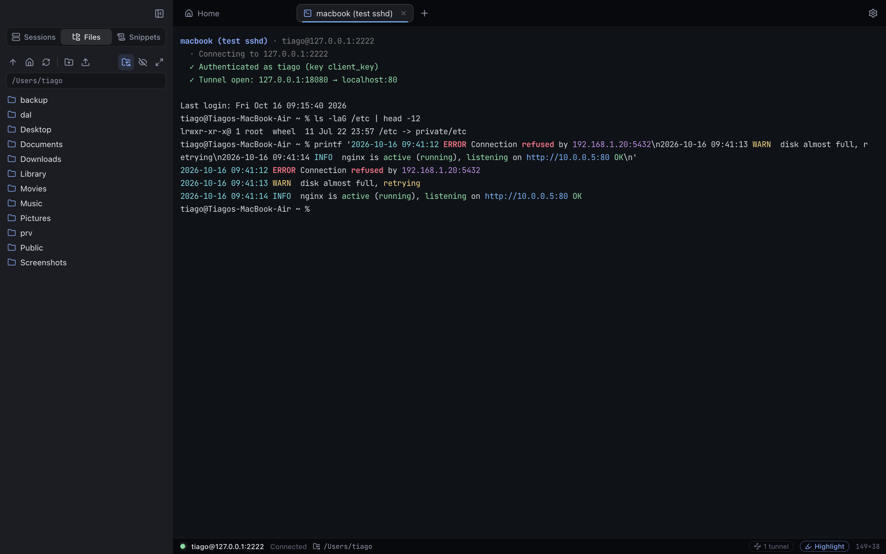
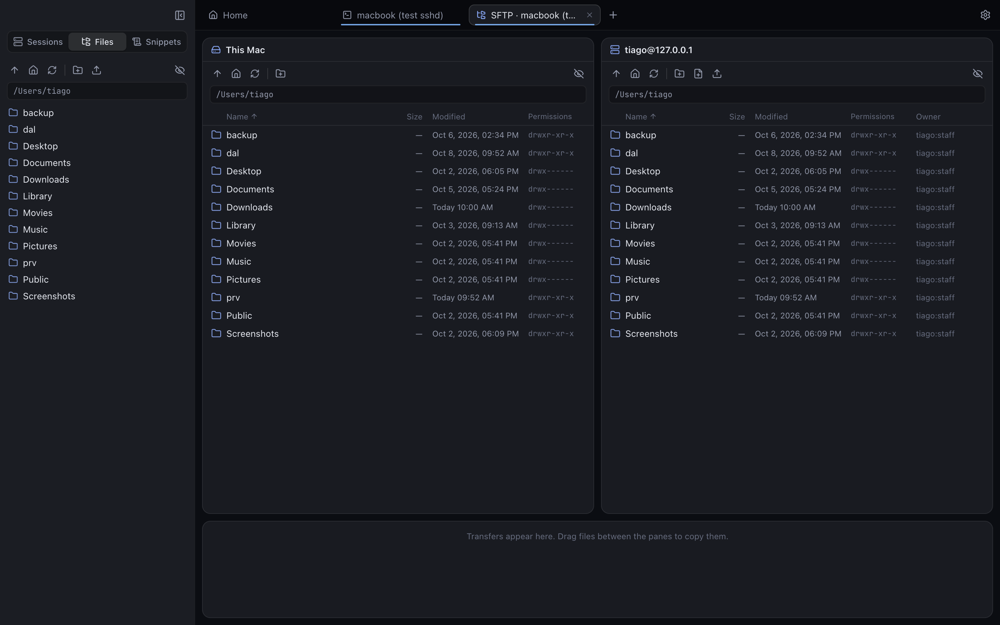
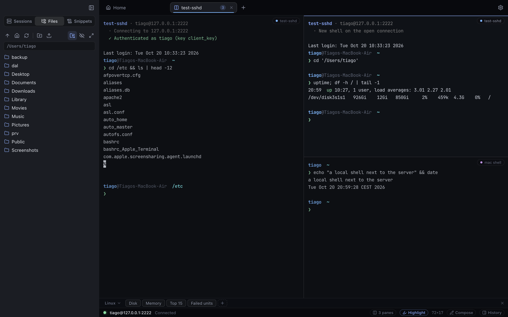

# Conduit

A modern SSH, SFTP and terminal app for macOS. It takes the parts people like most in MobaXterm, Royal TSX and Termius and puts them in a clean, dark interface.







## Features

**Terminal**
- Fast, GPU-rendered terminal (xterm.js + WebGL) with modern dark themes. *Ember* and *Forest* are tinted themes you can give to production or staging servers.
- **Syntax highlighting** of output, like MobaXterm: errors, warnings, success words, IPs, MAC addresses, URLs, dates and log levels. Rules are editable regexes. Output that is already colored, and full-screen apps like vim or htop, are left alone. Toggle per tab with ⇧⌘H.
- **Copy on select**, **right-click pastes**. ⌘C / ⌘V / ⌘A work as usual. ⌃-click or ⇧-right-click opens the context menu.
- Asks before pasting several lines at once, so you don't run multiple commands by accident.
- Zoom with ⌘+ / ⌘- / ⌘0, ⌘+scroll or trackpad pinch. Search the scrollback with ⌘F. 20,000 lines of scrollback by default.
- Mac line editing: ⌥←/→ jumps by word, ⌘←/→ goes to start/end of line, ⌥⌫ deletes a word.
- Local shell tabs (⌘T) with your normal zsh.
- **Split panes**: ⌘D splits right, ⇧⌘D splits down. ⌥⌘←→↑↓ moves between panes, ⇧⌘↩ maximizes one, drag the dividers to resize. Splitting an SSH terminal opens a new shell on the *same* connection (no second login or 2FA) in the same folder. Right-click a session → *Open in Split Pane*, or a folder → *Connect All in One Tab, Split*.
- **Button bar** under the terminal (like SecureCRT): one-click commands. Keep several bars (e.g. *Linux*, *Cisco IOS*) and pick one per session. Click sends to the focused terminal, ⌥-click to all panes of the tab. Right-click a button to edit, move or send it elsewhere; drag to reorder. Hide it with ⇧⌘U.
- **Compose bar** (⇧⌘E or *Compose* in the status bar, hidden by default): a slim line to write a command first and send it to this terminal, all panes of the tab, all connected terminals or the ones you pick. ↑ recalls earlier commands.
- **Broadcast** input to every connected terminal (⇧⌘B), like MobaXterm's MultiExec.
- **Snippets**: saved commands you send to the active terminal with one click.
- **Session logging** (off by default): Settings → Logging turns it on for all sessions, a session can override it, and any terminal can start/stop it from its right-click menu or ⌥⌘L. Clean text (colors and cursor codes removed) or raw, optional timestamps, your folder and file name pattern (`{session}_{date}_{time}`). A red *Log* chip shows while a terminal is logged.
- **Triggers** (Settings → Triggers): when a line of output matches a pattern, show a notification, mark the tab, or type an answer. Can be limited to sessions or hosts (`core-*`). A trigger that fires too often pauses itself.
- **Login scripts** (session → Automation): after connecting, wait for a text and type the answer, step by step — e.g. `terminal length 0` on a switch.
- **Server monitoring** in the status bar of SSH tabs (like MobaXterm): OS version, CPU, memory, disk, network traffic and uptime, every 3 seconds. Hover it for a detail card with CPU and network graphs of the last minutes, load, swap and free disk space. Less important values step aside in narrow windows. Toggle in Settings → Terminal or View → Server Monitoring.
- **Command history** panel on the right (⇧⌘Y or *History* in the status bar): the commands of this tab and the server's `~/.bash_history` / `~/.zsh_history`, with a filter. Click inserts, double-click runs, right-click saves a snippet.
- Session ended? Press **R** to reconnect or **Enter** to close the tab.

**Home**
- A keyboard-first launcher: type to find a session (name, host, user, folder), type `user@host` to connect directly, or type an action like *new*, *local*, *import*, *settings*. ↑↓ and ↵ do the rest.
- Pinned sessions (right-click → *Pin to Home*) and your recent sessions, with which ones are open right now.

**Workspaces**
- A named set of sessions that open together, each in a tab or split next to the one before. Mark one *Open when Conduit starts* to connect your daily servers automatically.
- Create them in Settings → Workspaces, from the open tabs (File → Workspaces → *Save Open Tabs as Workspace…*) or from a folder (right-click → *Save as Workspace…*). Open them from Home or the launcher.

**Sync & backup**
- **Sync between Macs** without an account (Settings → Sync & backup): Conduit keeps one encrypted file in a folder you choose — iCloud Drive, Dropbox or a network share. Sessions, folders, saved logins, snippets, button bars, triggers and workspaces sync; saved passwords only if you turn it on. Use the same passphrase on every Mac. Settings stay per Mac.
- **Backup**: File → Export → *Conduit Backup…* writes everything into one file; passwords are only included inside a passphrase-encrypted file. File → Import → *Conduit Backup…* adds to or replaces your data (a copy of the current data is kept first).
- **OpenSSH config**: File → Export → *OpenSSH Config…* writes your SSH sessions (host, port, user, key, jump host, tunnels) as `Host` entries.

**Session types** (wizard with templates, sensible defaults like ports pre-filled)
- **SSH**, **SFTP** (file browser only), **Local shell** (zsh/bash/fish on this Mac, with start folder)
- **Telnet** for switches and routers (window size, terminal type, automatic local echo)
- **Serial** consoles via USB-serial adapters / console cables (baud, data bits, parity, stop bits, flow control)
- **RDP** opens in Microsoft's free *Windows App*, **VNC** in macOS *Screen Sharing*
- **AWS EC2** (SSH preset with your .pem key) and **AWS Session Manager** (needs `brew install awscli session-manager-plugin`)
- **Command**: any command in a tab, e.g. `docker exec -it web sh` or `kubectl exec`

**Prompt**
- Clean two-line prompt for local shells and (optionally) SSH servers: user and folder on top, your command below, plus git branch, duration of slow commands and a red ❯ with the exit code after errors. The user name turns red as root. Styles *Conduit*, *Frame*, *Minimal* or the shell's own (Settings → Prompt, overridable per session). Nothing is written to the server; your own shell config is still loaded first.

**Sessions**
- MobaXterm-style tree with a **User sessions** root: right-click to create sessions and folders, *Move To* any folder, drag & drop, folder icons and colors.
- Saved sessions in folders with drag & drop ordering, color tags, search and notes.
- Logs in with an SSH agent, keys (incl. passphrase-protected keys), passwords or keyboard-interactive (2FA). Passwords can be saved, encrypted with a key kept in the macOS Keychain.
- **Saved logins** (Settings → Saved logins): store a username with its password or key once, e.g. `ops-admin`, and pick it under *Login* in any session. Change the password in one place for all sessions.
- Every password field has an eye button; saved passwords can be shown after Touch ID.
- Host key check against `~/.ssh/known_hosts` plus Conduit's own trust list, with a clear warning when a key changes.
- Jump hosts (ProxyJump), keep-alive, legacy algorithms for old switches and routers.
- **Tunnels**: local, remote and SOCKS5 (dynamic) port forwarding per session.
- Import from `~/.ssh/config` and from **MobaXterm** (`.mxtsessions` export: SSH, SFTP, Telnet, RDP and VNC sessions with their folders, jump gateways and key names).

**Files (SFTP)**
- **Files panel** next to the terminal (like MobaXterm). The sidebar follows the tabs: SSH tabs show Files, Home and local tabs show Sessions; a panel you pick by hand is remembered per tab. It **follows the folder you `cd` into** (bash/zsh). When following is off, a bar offers *Go there* / *Follow*.
- **Browse as root (sudo)**: offered when a folder is blocked and in the panel's right-click menu. Uses passwordless sudo, or asks for the sudo password once per connection. The panel does not switch to root by itself after `sudo -i` / `su -` in the terminal.
- **Dual-pane SFTP browser** (⇧⌘O): this Mac on the left, the server on the right, FileZilla-style. Drag files either way, or from Finder.
- Upload/download whole folders with a transfer queue (progress, speed, cancel), plus rename, delete, chmod, new file/folder, copy path, and "go here in terminal".
- **Edit remote files** in any Mac app. Saving uploads the file back automatically.
- Drop files from Finder onto an SSH terminal to upload them to the current folder.

### Keys from MobaXterm / PuTTY

OpenSSH keys (`id_ed25519`, `id_rsa`, `.pem`) work directly. PuTTY `.ppk` files only work if they are version 2 RSA keys. Convert anything else once:

```bash
brew install putty
puttygen mykey.ppk -O private-openssh -o ~/.ssh/mykey
```

## Install

```bash
npm install
npm run dist
```

This builds `release/mac-arm64/Conduit.app` and a DMG. Copy the app to /Applications (or run `npm run install-app`, which builds and copies it in one step).

The build is signed ad-hoc (no Apple developer certificate). Because you built it on this Mac, Gatekeeper doesn't block it. If you copy it to another Mac, right-click → Open the first time.

## Develop

```bash
npm run dev        # Vite dev server with hot reload + Electron
npm run start      # production build, run without packaging
npm run typecheck
npm run icon       # regenerate build/icon.icns from build/icon.svg
```

## Keyboard shortcuts

| Shortcut | Action |
| --- | --- |
| ⌘N / ⌘L / ⌘T | New session / quick connect / local terminal |
| ⌘D / ⇧⌘D | Split right / split down |
| ⌥⌘←→↑↓, ⇧⌘↩ | Move between panes, maximize pane |
| ⇧⌘O | Open SFTP browser for the current SSH tab |
| ⌘W, ⇧⌘W | Close pane (or tab), close tab with all panes |
| ⌘R, ⌥⌘D | Reconnect, duplicate tab |
| ⇧⌘U, ⇧⌘E | Button bar, compose bar |
| ⌥⌘L | Start/stop logging this terminal |
| ⌘1…⌘9, ⇧⌘[ / ⇧⌘] | Switch tabs |
| ⌘B, ⇧⌘1/2/3 | Toggle sidebar, show Sessions / Files / Snippets |
| ⌘F, ⌘K | Find in terminal, clear scrollback |
| ⌘+ / ⌘- / ⌘0 | Text size |
| ⇧⌘H | Syntax highlighting on/off for the tab |
| ⇧⌘B | Broadcast input to all terminals |
| ⌘, | Settings |

## Keychain prompt ("Conduit wants to use … Conduit Safe Storage")

Saved passwords are encrypted with a key kept in the macOS Keychain. macOS ties that key to the app's signature. The build is only signed ad hoc, so every update is a "new" app and macOS asks again.

- Click **Always Allow** (with your Mac login password) — it stays quiet until the next update.
- To keep it quiet across updates, create a local signing certificate once: Keychain Access → Keychain Access menu → Certificate Assistant → *Create a Certificate…* → Name `Conduit Local Signing`, Identity Type *Self-Signed Root*, Certificate Type *Code Signing* → Create. Then `npm run install-app` signs with it automatically; click *Always Allow* one last time.

## Where things are stored

`~/Library/Application Support/Conduit/`: `sessions.json`, `settings.json`, `snippets.json`, `credentials.json`, `automation.json` (button bars, triggers, workspaces), `known_hosts.json` and `secrets.json`. `secrets.json` holds passwords encrypted with Electron safeStorage, using a key from the macOS Keychain. Session logs go to `~/Documents/Conduit Logs` unless you choose another folder. Before a backup import Conduit copies the current files into a `before-import-…` folder there.

## How "follow terminal folder" works

After login Conduit checks with a separate command that your login shell is bash or zsh. It then types a one-line hook into the shell, hides its echo, and removes it from the shell history again. The hook makes the shell report its folder (OSC 7) before each prompt. Other shells (fish, network devices) are left untouched. You can turn it off globally or per session.

Note: on macOS's built-in bash 3.2 with `histappend` enabled, one old history line can be duplicated once per session. Linux bash 4.4+ and zsh are not affected.

## Architecture

```
electron/          main process (Node)
  main.js          window, menu, IPC
  ssh.js           connections, auth, host keys, shells, tunnels, shell integration
  sftp.js          file operations, transfer queue, edit-and-sync
  pty.js           local shells and commands (node-pty)
  telnet.js        Telnet client
  serial.js        serial consoles (stty + tty streams)
  launch.js        RDP (Windows App) and VNC (Screen Sharing)
  shellint.js      prompt + folder reporting for bash/zsh (scripts in electron/shell)
  importers.js     ~/.ssh/config and MobaXterm import
  logger.js        session logs (terminal stream → clean text)
  backup.js        backup export/import, OpenSSH config export
  sync.js          sync between Macs through an encrypted file
  vault.js         passphrase encryption (scrypt + AES-256-GCM)
  store.js         JSON storage + Keychain-encrypted secrets
src/               renderer (React + TypeScript, built with Vite)
  components/      tab bar, sidebar, terminal panes, button/compose bars, file panes, dialogs
  lib/             highlighter, themes, API bridge, file operations, split layouts, triggers
  store/app.ts     app state (zustand)
```
